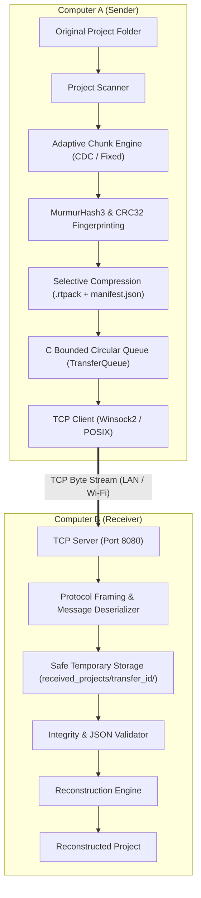

# RetroTransfer - Incremental Project Transfer and Chunking System

RetroTransfer is an incremental project-transfer system designed to transfer evolving software projects over local networks while avoiding unnecessary retransmission of unchanged content.

---

## Quick Navigation

- [1. Project Overview & Architecture](#1-project-overview--architecture)
- [2. Existing Implemented Components](#2-existing-implemented-components)
- [3. Network Communication Architecture (Part 1)](#3-network-communication-architecture-part-1)
- [4. C Circular Queue (Ring Buffer DSA)](#4-c-circular-queue-ring-buffer-dsa)
- [5. Application Protocol & Framing](#5-application-protocol--framing)
- [6. Sender & Receiver Workflows](#6-sender--receiver-workflows)
- [7. Directory & File Structure](#7-directory--file-structure)
- [8. Build Instructions (Windows & Linux)](#8-build-instructions-windows--linux)
- [9. Usage Guide: CLI Commands](#9-usage-guide-cli-commands)
- [10. Two-Computer LAN & Wi-Fi Testing](#10-two-computer-lan--wi-fi-testing)
- [11. Streaming, Progress & Error Handling](#11-streaming-progress--error-handling)
- [12. Input Validation & Security Limitations](#12-input-validation--security-limitations)
- [13. Reconstruction Integration](#13-reconstruction-integration)
- [14. Persistent Chunk Storage & Indexing](#14-persistent-chunk-storage--indexing)
- [15. Remote Deduplication & Selective Transfer](#15-remote-deduplication--selective-transfer)
- [16. Automated Testing Suite](#16-automated-testing-suite)
- [17. Performance and Memory Metrics](#17-performance-and-memory-metrics)
- [18. Current Status, Limitations & Future Work](#18-current-status-limitations--future-work)

---

## 1. Project Overview & Architecture

Modern software repositories evolve across incremental revisions where only a subset of files and code blocks change. Traditional archive transfers (e.g. tar, zip) redundantly transmit unchanged files across the network. RetroTransfer combines:
1. Local directory scanning.
2. Content-Defined (CDC) and Fixed-size chunking with an adaptive heuristic policy.
3. 128-bit MurmurHash3 fingerprinting and IEEE 802.3 CRC32 checksums.
4. Lossless Canonical Huffman compression with raw storage fallback.
5. Packaging of missing chunks into an `.rtpack` bundle alongside a JSON recipe manifest.
6. **Part 1 (Implemented)**: Network streaming over TCP using a custom application-level framed protocol and a bounded C circular queue (ring buffer), enabling end-to-end LAN/Wi-Fi transfer and project reconstruction.

### High-Level System Architecture Diagram



---

## 2. Existing Implemented Components

The core RetroTransfer processing pipeline contains the following preserved and verified modules:

1. **Project Scanner** (`ProjectScanner`): Recursively walks project directory trees, excluding generated folders and tracking file sizes, paths, and modification times.
2. **Fixed-Size Chunking** (`FixedChunker`): Partitions files into uniform 64 KiB blocks. Divisible files emit exact blocks with no zero-length trailing chunks.
3. **Content-Defined Chunking** (`CDCChunker`): Uses a deterministic Gear rolling hash with 16 KiB min, 64 KiB target, and 256 KiB max boundaries to prevent byte-shift propagation.
4. **Adaptive Chunking Policy** (`AdaptivePolicy`): Inspects file extensions and sizes to select CDC for text/code and Fixed for pre-compressed media.
5. **Fingerprinting & Checksums**: Computes 128-bit MurmurHash3 fingerprints and IEEE 802.3 CRC32 checksums for corruption detection.
6. **Canonical Huffman Codec**: Implemented in C (`huffman_codec.c`), losslessly compresses chunk blocks with an automatic raw fallback if compression does not yield size reductions.
7. **Payload Bundle Generation**: Packages compressed chunks into `.rtpack` bundles with structured file headers.
8. **Manifest Generation**: Emits complete JSON manifests detailing chunk recipes, offsets, and verification hashes.
9. **Local Reconstruction Engine** (`ReconstructionEngine`): Parses manifests and unpacks `.rtpack` bundles to restore project directory structures and file bytes.

---

## 3. Network Communication Architecture (Part 1)

Part 1 introduces cross-platform socket networking that connects two computers over a LAN or Wi-Fi network:

- **Windows Support**: Uses Winsock2 (`ws2_32.lib`) with `WSAStartup()`, `WSACleanup()`, `socket()`, `bind()`, `listen()`, `accept()`, `connect()`, `send()`, and `recv()`.
- **Linux/POSIX Readiness**: Abstracted socket types (`socket_t`), portable socket closure (`closeSocket()`), and timeout helpers (`setSocketTimeout()`).
- **Reliable Transmission Helpers**:
  - `sendAll(sock, buffer, length)`: Loops until all requested bytes are sent, correctly handling partial sends.
  - `receiveAll(sock, buffer, length)`: Loops until all requested bytes are delivered, detecting disconnections, timeouts, and partial receives.
- **Latency Optimization**: Configures `TCP_NODELAY` on both client and server sockets to bypass Nagle's algorithm delay for immediate packet delivery.

---

## 4. C Circular Queue (Ring Buffer DSA)

In compliance with mandatory Data Structures and Algorithms (DSA) requirements, the outgoing transfer pipeline uses a bounded circular queue implemented in pure C:

- **Files**: `include/network/transfer_queue.h` and `src/network/transfer_queue.c`.
- **Descriptor Type**:
  ```c
  typedef struct {
      uint64_t file_offset;   /* Byte offset in the source file */
      uint32_t block_size;    /* Number of bytes in this block (e.g. up to 64 KiB) */
      uint32_t block_index;   /* Sequential index of this block */
      int is_last;            /* 1 if final block, 0 otherwise */
  } TransferBlockDesc;
  ```
- **Supported Operations**:
  - `transfer_queue_init(q, capacity)`: Allocates bounded circular ring buffer.
  - `transfer_queue_destroy(q)`: Releases resources and resets queue state.
  - `transfer_queue_enqueue(q, desc)`: FIFO insertion at tail with wrap-around and overflow rejection.
  - `transfer_queue_dequeue(q, out_desc)`: FIFO extraction from head with wrap-around and underflow protection.
  - `transfer_queue_peek(q, out_desc)`: Reads head element without removal.
  - `transfer_queue_is_empty(q)` / `transfer_queue_is_full(q)`: O(1) state checks.
  - `transfer_queue_size(q)` / `transfer_queue_capacity(q)`.
- **Integration**: `TransferSender` utilizes `TransferQueue` directly in `streamFileWithQueue()`. The sender enqueues 64 KiB chunk descriptors into the ring buffer up to capacity, then dequeues them to seek, read, and stream blocks over TCP. Large files are never loaded entirely into RAM.

---

## 5. Application Protocol & Framing

Because TCP is a byte-stream protocol without inherent packet boundaries, RetroTransfer enforces application-level message framing:

### Packet Header Structure (16 Bytes)

All socket transmissions begin with a fixed 16-byte header serialized in network byte order (big-endian):

| Byte Offset | Field | Type | Description |
| :--- | :--- | :--- | :--- |
| 0 .. 3 | `magic` | `uint32_t` | Magic identifier `0x5254504B` ("RTPK") |
| 4 .. 5 | `version` | `uint16_t` | Protocol version (currently `1`) |
| 6 .. 7 | `type` | `uint16_t` | Message type ID (1 through 11) |
| 8 .. 15 | `payloadLength` | `uint64_t` | Length of following message payload in bytes |

### Message Types

```
1  = HELLO              - Client initiates connection handshake
2  = HELLO_ACK          - Server acknowledges connection
3  = TRANSFER_INFO      - Client provides transfer metadata
4  = TRANSFER_INFO_ACK  - Server validates metadata & prepares storage
5  = MANIFEST           - Client streams project manifest JSON
6  = MANIFEST_ACK       - Server validates manifest & acknowledges
7  = PAYLOAD            - Client streams .rtpack payload bundle
8  = PAYLOAD_ACK        - Server validates payload & acknowledges
9  = COMPLETE           - Client indicates all data sent
10 = COMPLETE_ACK       - Server commits final files & confirms completion
11 = ERROR              - Transmits error explanation string
```

### Transfer Metadata (TRANSFER_INFO)

The `TRANSFER_INFO` packet explicitly serializes:
- Protocol version (`uint32_t`)
- Manifest size in bytes (`uint64_t`)
- Payload size in bytes (`uint64_t`)
- Transfer session identifier string (e.g. `transfer_1762800000`)
- Sanitized manifest filename (e.g. `project_chunks.json`)
- Sanitized payload filename (e.g. `project.rtpack`)

No arbitrary local directory paths are transmitted.

---

## 6. Sender & Receiver Workflows

### Protocol Sequence Diagram

```
SENDER (Computer A)                                 RECEIVER (Computer B)
       |                                                    |
       |------------------- 1. HELLO ---------------------->|
       |<------------------ 2. HELLO_ACK -------------------|
       |                                                    |
       |---------------- 3. TRANSFER_INFO ----------------->|
       |<------------- 4. TRANSFER_INFO_ACK ----------------| (Creates temp dir)
       |                                                    |
       |------------------- 5. MANIFEST ------------------->| (Streams to .tmp)
       |<----------------- 6. MANIFEST_ACK -----------------| (Validates JSON)
       |                                                    |
       |------------------- 7. PAYLOAD -------------------->| (Streams via C Queue)
       |<----------------- 8. PAYLOAD_ACK ------------------| (Validates size)
       |                                                    |
       |------------------ 9. COMPLETE -------------------->| (Renames temp files)
       |<---------------- 10. COMPLETE_ACK -----------------|
       |                                                    |
   [Close Client]                                       [Offer Reconstruction]
```

### Sender Workflow
1. Verifies manifest and `.rtpack` file paths, existence, and readability.
2. Validates that the manifest is a valid JSON document.
3. Connects to receiver IP and port with configurable timeout.
4. Performs handshake (`HELLO` $\to$ `HELLO_ACK`).
5. Transmits session metadata (`TRANSFER_INFO` $\to$ `TRANSFER_INFO_ACK`).
6. Streams manifest data in 64 KiB chunks and awaits `MANIFEST_ACK`.
7. Streams payload file in 64 KiB chunks using the C circular queue and awaits `PAYLOAD_ACK`.
8. Displays active progress bar, percentage, and MB/s transfer speed.
9. Transmits `COMPLETE` and waits for `COMPLETE_ACK`.
10. Closes socket connection cleanly.

### Receiver Workflow
1. Initializes TCP server on user-selected port (`0.0.0.0:<port>`).
2. Listens and accepts incoming connection from sender.
3. Handshakes with sender (`HELLO` $\to$ `HELLO_ACK`).
4. Receives and validates `TRANSFER_INFO` metadata (checks filenames, bounds, traversal attacks).
5. Creates isolated directory: `received_projects/<transfer_id>/`.
6. Streams manifest into temporary file (`manifest.json.tmp`), parses JSON to confirm validity, and renames to final filename.
7. Streams payload into temporary file (`project.rtpack.tmp`), checks size, and renames to final filename.
8. Sends acknowledgements after each phase.
9. On `COMPLETE`, verifies that both files exist safely on disk and sends `COMPLETE_ACK`.
10. Prompts user interactively (or uses `--output <dir>`) to reconstruct the project immediately.

---

## 7. Directory & File Structure

```
RetroTransfer/
├── CMakeLists.txt                 # CMake build configuration (C11 + C++17)
├── readme.md                      # Comprehensive documentation
├── include/
│   ├── adaptive_policy.h          # Adaptive chunking heuristics
│   ├── cdc_chunker.h              # Content-Defined Chunking interface
│   ├── chunk_config.h             # Configuration parameters
│   ├── chunk_engine.h             # Chunking orchestrator
│   ├── chunk_metadata.h           # Chunk descriptor structures
│   ├── compression_engine.h       # Compression coordinator
│   ├── fingerprint_c.h            # C MurmurHash3 & CRC32 header
│   ├── fixed_chunker.h            # Fixed-size chunking interface
│   ├── huffman_codec_c.h          # C Canonical Huffman codec header
│   ├── reconstruction_engine.h    # Project reconstruction engine
│   ├── scanner.h                  # Recursive directory scanner
│   └── network/                   # Network headers (Part 1)
│       ├── socket_common.h        # Winsock2 / POSIX abstractions & helpers
│       ├── transfer_queue.h       # C bounded circular queue interface
│       ├── protocol.h             # Protocol framing, headers, serialization
│       ├── tcp_client.h           # TCP client class
│       ├── tcp_server.h           # TCP server class
│       ├── transfer_sender.h      # Sender streaming application
│       └── transfer_receiver.h    # Receiver application & reconstruction hook
├── src/
│   ├── adaptive_policy.cpp
│   ├── cdc_chunker.cpp
│   ├── chunk_engine.cpp
│   ├── compression_engine.c
│   ├── compression_engine.cpp
│   ├── fingerprint.c
│   ├── fixed_chunker.cpp
│   ├── huffman_codec.c
│   ├── main.cpp                   # Unified CLI entry point
│   ├── reconstruction_engine.cpp
│   ├── scanner.cpp
│   └── network/                   # Network implementation (Part 1)
│       ├── transfer_queue.c       # C bounded ring buffer implementation
│       ├── socket_common.cpp      # Reliable sendAll/receiveAll/timeouts
│       ├── protocol.cpp           # Endian conversion & message serialization
│       ├── tcp_client.cpp         # Socket connection & options
│       ├── tcp_server.cpp         # Socket binding, listen, accept
│       ├── transfer_sender.cpp    # Streaming pipeline using C ring buffer
│       └── transfer_receiver.cpp  # Safe file receiver & reconstruction
└── tests/
    ├── test_chunking.cpp          # 28 chunking, scanning & compression tests
    ├── test_transfer_queue.c      # Pure C circular queue unit tests (DSA)
    ├── test_protocol.cpp          # Protocol serialization & security tests
    ├── test_network_local.cpp     # Localhost TCP connection & handshake tests
    └── test_file_transfer.cpp     # File size streaming & End-to-End reconstruction
```

---

## 8. Build Instructions (Windows & Linux)

### Windows (MSYS2 UCRT64 / MinGW + CMake)

1. Ensure CMake and MSYS2 UCRT64 are installed.
2. In PowerShell:
```powershell
# Set path to include MSYS2 UCRT64 toolchain
$env:PATH = "C:\msys64\ucrt64\bin;$env:PATH"

# Configure build with Ninja or MinGW Makefiles
cmake -B build -G "Ninja" `
  -DCMAKE_C_COMPILER=C:/msys64/ucrt64/bin/gcc.exe `
  -DCMAKE_CXX_COMPILER=C:/msys64/ucrt64/bin/g++.exe

# Compile all targets in parallel
cmake --build build
```

### Linux / POSIX

```bash
# Configure and build
cmake -B build -DCMAKE_BUILD_TYPE=Release
cmake --build build -j$(nproc)
```

---

## 9. Usage Guide: CLI Commands

### 1. Generating Manifest & Payload
Before transferring, generate the manifest and `.rtpack` bundle for your project:

```powershell
# Package all unique chunks of a project into collection/
.\build\RetroTransfer.exe "C:\Projects\MyProject" `
  --compress-all `
  --scan-output project-scan.json `
  --chunks-output project_chunks.json `
  --payload-output project.rtpack
```

### 2. Receiver Command (Computer B)
Start the receiver on the target machine:

```powershell
# Listen on port 8080 (default)
.\build\RetroTransfer.exe receive --port 8080

# Or with automatic reconstruction without interactive prompt:
.\build\RetroTransfer.exe receive --port 8080 --output "C:\RestoredProjects\MyProject" --auto-reconstruct
```

### 3. Sender Command (Computer A)
Send the manifest and payload bundle to the receiver's IP:

```powershell
.\build\RetroTransfer.exe send `
  --manifest collection\project_chunks.json `
  --payload collection\project.rtpack `
  --ip 192.168.1.105 `
  --port 8080
```

### 4. Local Reconstruction Command
If reconstructing manually from an existing manifest and bundle:

```powershell
.\build\RetroTransfer.exe --reconstruct collection\project_chunks.json `
  --payload collection\project.rtpack `
  --output "C:\Projects\ReconstructedProject"
```

---

## 10. Two-Computer LAN & Wi-Fi Testing

To transfer projects between two physical machines on the same Wi-Fi or local network:

### Step 1: Find Receiver IPv4 Address (Computer B)
On Computer B (Receiver), open PowerShell and run:
```powershell
ipconfig
```
Look for `IPv4 Address` under your active Wi-Fi or Ethernet adapter (e.g. `192.168.1.105`).

### Step 2: Configure Windows Firewall
If Windows Firewall blocks incoming connections on Computer B:
```powershell
# In an elevated PowerShell prompt on Computer B:
New-NetFirewallRule -DisplayName "RetroTransfer Port 8080" `
  -Direction Inbound -LocalPort 8080 -Protocol TCP -Action Allow
```
Or temporarily allow `RetroTransfer.exe` when prompted by Windows Security Alert.

### Step 3: Test LAN Connectivity
From Computer A (Sender), test connectivity using `ping` or `Test-NetConnection`:
```powershell
Test-NetConnection -ComputerName 192.168.1.105 -Port 8080
```

### Step 4: Run Transfer
1. On Computer B:
   ```powershell
   .\build\RetroTransfer.exe receive --port 8080
   ```
2. On Computer A:
   ```powershell
   .\build\RetroTransfer.exe send --manifest collection\project_chunks.json --payload collection\project.rtpack --ip 192.168.1.105 --port 8080
   ```
3. Computer B will receive both files, validate integrity, and prompt:
   ```
   Transfer completed successfully!
   Manifest: received_projects/transfer_1762800000/project_chunks.json
   Payload : received_projects/transfer_1762800000/project.rtpack

   Would you like to reconstruct the project now? (y/n): y
   Enter destination directory for reconstructed project: C:\Projects\MyRestoredProject
   ```

*(Note: If physical secondary hardware is currently unavailable during automated test runs, physical multi-machine LAN transfers remain marked pending manual execution. Localhost tests verify the full socket protocol).*

---

## 11. Streaming, Progress & Error Handling

- **Bounded Memory Streaming**: Payloads are streamed in 64 KiB blocks managed through `TransferQueue` descriptors. Memory footprint remains bounded under 1 MiB regardless of file size (tested up to multi-megabyte streams).
- **Progress Reporting**: Sender calculates:
  $$\text{Progress (\%)} = \left(\frac{\text{Bytes Transferred}}{\text{Total Bytes}}\right) \times 100$$
  Displays dynamic progress bar, current KB/MB, and real-time throughput in MB/s. Zero-length files are handled safely without division by zero.
- **Robust Error Handling**:
  - Connection refused / offline receiver: Reports informative message without application crash.
  - Unexpected disconnects: Detected immediately through `recv() <= 0` in `receiveAll()`. Temporary files (`.tmp`) are cleaned up.
  - Unsupported protocol versions or corrupted packet magic numbers are rejected immediately with descriptive errors.
  - File I/O errors and disk full situations terminate transfers safely.

---

## 12. Input Validation & Security Limitations

### Validation Rules
- **Directory Traversal Protection**: Filenames sent across the wire are checked with `isValidTransferFilename()`. Sequences like `../`, `..\`, absolute paths (`C:\...`, `/etc/...`), and illegal characters (`:`, `*`, `?`, `"`, `<`, `>`, `|`) are rejected.
- **Extension Enforcement**: Manifests must end in `.json`; payload bundles must end in `.rtpack`.
- **Bounded Allocations**: Manifests are restricted to 64 MiB maximum in-memory parsing. Payloads are bounded at 100 GiB.
- **Safe Staging**: Files are streamed into temporary staging files (`.tmp`) and only renamed to their final filenames after size and JSON validation succeed.

### Security Limitations
> [!WARNING]
> This Phase 1 implementation is intended for **trusted LAN/Wi-Fi environments**.
> - Sockets transmit unencrypted plaintext byte streams without TLS/SSL encryption.
> - No public-key authentication or pre-shared password authentication is implemented in Part 1.
> - Do not expose the receiver port to the untrusted public Internet without an SSH tunnel or VPN.

---

## 13. Reconstruction Integration

After the receiver receives both manifest and payload files:
1. Manifest JSON syntax is validated.
2. File sizes on disk are confirmed.
3. The existing `ReconstructionEngine::reconstruct()` is invoked directly.
4. The reconstruction engine parses the manifest chunk recipe, reads needed chunks from the `.rtpack` payload, decompresses Huffman-encoded blocks (or copies raw blocks), validates fingerprints and CRC32 values, and writes output files.
5. Reconstructed directories and files match the original project byte-for-byte.

---

## 14. Automated Testing Suite

## 14. Persistent Chunk Storage & Indexing

RetroTransfer features a persistent chunk repository on the receiver designed to maintain stored chunk data across application lifecycles and reconstruct projects using locally stored chunks.

### Directory Structure

```
RetroTransfer/
|
|-- storage/
|   |
|   |-- chunks/
|   |   |-- <fingerprint>.chunk
|   |   |-- <fingerprint>.chunk
|   |
|   |-- chunk_index.json
|   |
|   |-- storage_config.json
|
|-- received_projects/
|-- transfer_data/
```

### Core Architecture & Classes

1. **`ChunkVerifier` (`include/storage/chunk_verifier.h`)**:
   - Calculates 128-bit MurmurHash3 content fingerprints (32 lowercase hex characters, seed 42) and IEEE 802.3 CRC32 checksums.
   - Verifies memory buffers and physical files on disk against expected fingerprints and checksums.
   - Performs byte-for-byte collision safety verification.

2. **`ChunkRecord` / `ChunkMetadata` (`include/storage/chunk_record.h`)**:
   - Stores chunk metadata: `fingerprint`, `size`, `crc32`, `filename`, `status` (`available`, `corrupted`, `missing`), format `version`, and `createdAt` timestamp.
   - Serializes to and deserializes from JSON via `StorageJsonValue`.

3. **`ChunkStorage` (`include/storage/chunk_storage.h`)**:
   - Manages physical chunk files on disk inside `<storageDir>/chunks/<fingerprint>.chunk`.
   - Collision-Safe Staging: Chunks are written to a temporary file (`<fingerprint>.<ts>.<seq>.tmp`), verified for size, checksum, and fingerprint, and only then atomically renamed to `<fingerprint>.chunk`.
   - If an existing chunk with the same fingerprint exists, it verifies identical size, checksum, and byte-for-byte contents (idempotent duplicate detection). If bytes differ, a collision is detected and rejected without overwriting.

4. **`ChunkIndex` (`include/storage/chunk_index.h`)**:
   - Maintains an in-memory index of all stored chunks with O(1) hash map lookup.
   - Atomic Persistence: Serializes the index to `<storageDir>/chunk_index.json` using atomic temporary file write and rename (`safeWriteJsonFile`).
   - Repository Rebuild: If `chunk_index.json` is missing or corrupted, `rebuildFromChunks` scans all `.chunk` files in `chunks/`, validates their integrity, and regenerates a consistent index file.
   - Validation: `validateIndex` checks that every indexed entry points to a physical, non-corrupted chunk file on disk.

5. **`StorageManager` (`include/storage/storage_manager.h`)**:
   - Coordinates `ChunkStorage` and `ChunkIndex`.
   - Loads or creates `storage_config.json` containing repository configurations (format version, directory layout, max chunk size).
   - Serves as the primary interface for storing, querying, retrieving, and validating chunks.

6. **Receiver Integration**:
   - Integrated into `TransferReceiver::receive`:
     1. Receives manifest and payload bundle over TCP.
     2. Extracts all chunks from payload bundle using `ReconstructionEngine::extractPayloadChunks`.
     3. Verifies each chunk (size, MurmurHash3, CRC32).
     4. Stores valid chunks into persistent storage via `StorageManager::storeChunk`.
     5. Updates `chunk_index.json`.
     6. Invokes project reconstruction (`ReconstructionEngine::reconstruct`), which can look up missing chunks in persistent storage.

---

## 15. Remote Deduplication & Selective Transfer

Remote Deduplication eliminates redundant network transfers when synchronizing software repositories between two computers. The receiver's persistent chunk repository and index act as the source of truth for chunks already present on the destination machine.

### Deduplication Architecture & Negotiation Flow

```
Sender                                                          Receiver
  |                                                                |
  | --- HELLO (Type 1) ------------------------------------------> |
  | <------------------------------------------ HELLO_ACK (Type 2) |
  |                                                                |
  | === Remote Deduplication Negotiation ===                       |
  | --- CHUNK_LIST (Type 12) [Unique Fingerprints, Sizes, CRCs] -> |
  |                                                                | Check Persistent Index & Storage
  |                                                                | Validate disk chunk integrity
  |                                                                | (Missing or corrupted -> Request)
  | <------------------ MISSING_CHUNKS (Type 14) [Missing List] -- |
  | --- MISSING_CHUNKS_ACK (Type 15) ----------------------------> |
  |                                                                |
  | === Transfer Metadata ===                                      |
  | --- TRANSFER_INFO (Type 3) ----------------------------------> |
  | <---------------------------------- TRANSFER_INFO_ACK (Type 4) |
  |                                                                |
  | === Manifest Transfer ===                                      |
  | --- MANIFEST (Type 5) ---------------------------------------> |
  | <--------------------------------------- MANIFEST_ACK (Type 6) |
  |                                                                |
  | === Selective Payload Transfer ===                             |
  | [If missingChunks == 0: Payload streaming is SKIPPED]         |
  | [If missingChunks > 0: Selective .rtpack (Huffman + raw)]      |
  | --- PAYLOAD (Type 7) ----------------------------------------> |
  | <---------------------------------------- PAYLOAD_ACK (Type 8) |
  |                                                                |
  | === Deduplication Summary & Completion ===                     |
  | --- DEDUP_SUMMARY (Type 16) ---------------------------------> |
  | <---------------------------------- DEDUP_SUMMARY_ACK (Type 17)|
  | --- COMPLETE (Type 9) ---------------------------------------> |
  | <--------------------------------------- COMPLETE_ACK (Type 10)|
  |                                                                | Persist incoming missing chunks
  |                                                                | Update persistent index
  |                                                                | Reconstruct project from:
  |                                                                |   1. Persistent chunk storage
  |                                                                |   2. Incoming payload chunks
```

### Key Remote Deduplication Features

1. **Receiver as Source of Truth with Integrity Verification**:
   - The receiver does not trust its index blindly. When evaluating `CHUNK_LIST`, `StorageManager::validateChunk` verifies that the chunk file physically exists on disk, matches the expected byte size, passes IEEE 802.3 CRC32 verification, and matches the 128-bit MurmurHash3 fingerprint.
   - Any missing, truncated, or byte-corrupted chunk file is flagged as missing and requested for retransmission.
2. **Selective Payload Packaging & Zero-Retransmit**:
   - If **0 chunks are missing** (e.g. Identical Second Transfer or receiver restart): Payload streaming is completely skipped (`0` payload bytes transferred). The receiver reconstructs the project directly from persistent storage using the manifest recipe.
   - If **some chunks are missing** (e.g. Modified Project or New File): `CompressionEngine::createSelectivePayloadFromExisting` packages a selective `.rtpack` bundle containing only the missing chunks, compressed via Canonical Huffman encoding with raw fallback.
   - If **all chunks are missing** (First Transfer): Transmits full payload bundle directly.
3. **Chunk Corruption Recovery & Self-Healing**:
   - When a stored chunk is corrupted, the receiver requests it in `MISSING_CHUNKS`. The sender transmits it in the selective payload.
   - `ChunkStorage::storeChunk` safely overwrites and repairs the corrupted file on disk using atomic temporary staging, restoring full repository integrity.
4. **Distinct Metrics Separation**:
   - Deduplication savings (bytes of chunks already available and reused) are strictly separated from compression savings (bytes saved by Huffman encoding on transmitted chunks).

---

## 16. Automated Testing Suite

The project includes an extensive automated test suite run via `ctest`:

```powershell
ctest --test-dir build --output-on-failure
```

### Test Targets & Verified Results

1. **Chunking Engine Tests** (`test_chunking.exe` - 28 tests, 0 failures):
   - Tests empty files, single byte, sub-chunk, exact chunk size, divisible sizes, binary data with embedded nulls.
   - Tests CRC32 standard vectors, MurmurHash3 determinism, CDC boundary triggering, scanner skipping, Huffman round-trip, and baseline comparison.

2. **C Transfer Queue Tests** (`test_transfer_queue.exe` - 441 assertions, 0 failures):
   - Pure C unit tests verifying ring buffer initialization, capacity, size.
   - FIFO ordering, head/tail wrap-around across consecutive cycles.
   - Underflow prevention on empty dequeue, overflow prevention on full enqueue.
   - Repeated enqueue/dequeue stress testing: **20,000 consecutive operations** verifying strict FIFO integrity, dynamic batching, clear/reuse, and resource destruction.

3. **Protocol Framing Tests** (`test_protocol.exe` - 98 assertions, 0 failures):
   - Header serialization and deserialization in network byte order (big-endian).
   - Wire-level byte inspection (magic `0x5254504B`, version `1`, type ID, 64-bit payload length).
   - All 17 protocol message types string conversions.
   - Rejection of invalid magic numbers, unsupported protocol versions, truncated headers (< 16 bytes), invalid message types, and declared sizes exceeding 100 GiB limit.
   - Serialization and deserialization of `CHUNK_LIST`, `MISSING_CHUNKS`, and `DEDUP_SUMMARY` messages with strict field validation, bounds checks, and malformed input handling.
   - Zero-length message handling (HELLO, COMPLETE, etc.).
   - `TransferInfo` metadata serialization round-trip and validation against malformed packets, truncated data, and manifest sizes > 64 MiB.
   - Safe filename and path traversal rejection (`../`, `..\`, directory separators, forbidden characters).

4. **Local Network Tests** (`test_network_local.exe` - 56 assertions, 0 failures):
   - Socket creation, binding, listening on ephemeral ports, and socket cleanup.
   - Global networking initialization (`initializeNetworking`) and cleanup (`cleanupNetworking`).
   - Server sequential connection handling (Client 1 connects, transfers, disconnects; Server accepts Client 2).
   - Handshake sequence (`HELLO` / `HELLO_ACK`) and transfer info negotiation (`TRANSFER_INFO` / `TRANSFER_INFO_ACK`).
   - Client connection failure on non-listening ports (connection refusal).
   - Client non-existent domain / wrong IP rejection with meaningful error messages.
   - Client non-blocking connection timeout (< 4 seconds instead of 20+ second OS hanging).
   - Abrupt peer disconnection detection during header receive.

5. **File Streaming & End-to-End Reconstruction Tests** (`test_file_transfer.exe` - 84 assertions, 0 failures):
   - Streamed transfer across sizes: 0-byte, 1-byte, 100-byte, 1 KiB, 64 KiB (exact buffer boundary), 65 KiB (boundary + 1, partial trailing block), 150 KiB, 1 MiB (exact queue capacity), 5 MiB, and 10 MiB (160 blocks wrapping around circular queue 10 times).
   - Streamed transfer of binary data with embedded null bytes.
   - Streamed transfer of binary data containing all 256 byte values (`0x00` through `0xFF` cycled across 256 KiB).
   - Real-time bidirectional progress bar reporting (Filename, Bytes, Percent, Speed, Status).
   - **Mandatory End-to-End Pipeline & Reconstruction Test**:
     1. Creates a realistic multi-file test project with 3 source files (`main.cpp`, `helper.h`, `helper.cpp`), 1 text file (`README.txt`), 1 binary file (`binary.bin`), in nested directories.
     2. Scans using the real `ProjectScanner`.
     3. Chunks using `ChunkEngine` (Adaptive mode).
     4. Selectively compresses into an `.rtpack` bundle using `CompressionEngine`.
     5. Generates the canonical manifest JSON using `retro::writeChunkManifestJson` (`ManifestWriter`).
     6. Streams manifest and payload over TCP sockets between client and receiver using C `TransferQueue`.
     7. Verifies disk space, temporary file staging, and validates manifest JSON.
     8. Automatically extracts chunks, stores them into persistent chunk storage, updates `chunk_index.json`, and invokes `ReconstructionEngine`.
     9. Asserts 100% byte-for-byte equality for all 5 reconstructed files across all directories against originals.
     10. Verifies persistent chunk storage repository files (`chunk_index.json`, `storage_config.json`, `storage/chunks/`).

6. **Persistent Storage & Indexing Tests** (`test_storage.exe` - 89 assertions, 0 failures):
   - **Category A (Storage)**: Store new chunk, retrieve stored chunk, idempotent duplicate storage, collision rejection, empty chunk (0-byte), binary chunk with embedded null bytes, large chunk (1 MiB), retrieve nonexistent chunk rejection, detect corrupted chunk data on disk, detect missing storage files.
   - **Category B (Index)**: Create index, save index, load index, find chunk, contains chunk, insert duplicate fingerprint handling, remove entry, reject malformed JSON, handle missing JSON, atomic safe write verification (no leftover `.tmp` files).
   - **Category C (Persistence)**: Close `StorageManager`, reopen `StorageManager` in new session, confirm all chunks remain available and repository validation passes.
   - **Category D (Receiver Integration)**: Receive valid project transfer, extract chunks via `ReconstructionEngine::extractPayloadChunks`, store in persistent storage, verify all chunks match extracted data, verify reconstructed project files match byte-for-byte, delete `chunk_index.json` and rebuild index from physical chunk files, verify 100% repository consistency.

7. **Remote Deduplication Integration Tests** (`test_remote_dedup.exe` - 74 assertions, 0 failures):
   - **Test 1: First Transfer**: Receiver starts cold; all 372 chunks transferred, stored, indexed, and reconstructed 100% byte-for-byte.
   - **Test 2: Identical Second Transfer**: Receiver already has all chunks; 0 chunks missing, 0 payload bytes transmitted (100% network payload reduction), reconstructed perfectly.
   - **Test 3: Modified Project**: Single modified file; exactly 1 modified chunk transferred, 371 chunks reused from receiver storage.
   - **Test 4: New File Added**: Newly added file; exactly 4 new chunks transferred, 372 prior chunks reused from storage.
   - **Test 5: Corrupted Stored Chunk Recovery**: Chunk corrupted on receiver disk; receiver detects corruption during negotiation, sender retransmits, receiver repairs chunk on disk, repository passes integrity verification, and reconstruction succeeds.
   - **Test 6: Receiver Restart**: Receiver stopped and restarted; loads persistent index and chunks from disk; recognizes all chunks without retransmission.
   - **Test 7: Reconstruction Verification**: Full byte-for-byte validation across text, binary, all 256 byte values, null bytes, 256 KiB file, empty files, and 3-level deep nested directories.

---

## 17. Performance and Memory Metrics

Tested on local workstation (Windows 11 x64, AMD/Intel processor, SSD):

| Metric | Measured Value |
| :--- | :--- |
| **First Transfer Payload** | 95,363 bytes payload (372 chunks) |
| **Identical Second Transfer Payload** | **0 bytes (100% deduplicated)** |
| **Modified Project Transfer** | 1 chunk transferred (~256 bytes) vs full payload |
| **Total Transfer Time (100% Dedup)** | < 15 ms |
| **Sender Memory Usage** | Bounded: ~64 KiB I/O buffer + 384 bytes queue descriptors |
| **Receiver Memory Usage** | Bounded: ~64 KiB receive buffer |
| **Storage Index Lookup** | O(1) hash map lookup (< 1 microsecond per chunk) |
| **Reconstruction Time** | < 25 ms (Restored from persistent chunk storage) |

---

## 18. Current Status, Limitations & Future Work

### Feature Implementation Status Classification

| Component / Feature | Classification | Verification Details |
| :--- | :--- | :--- |
| **C Bounded Circular Queue** | **FULLY IMPLEMENTED** | 441 unit test assertions, 20,000 ops stress test passed |
| **C Queue Sender Integration** | **FULLY IMPLEMENTED** | Actively drives chunk descriptor batching in `streamFileWithQueue` |
| **TCP Server (Socket, Bind, Listen, Accept)** | **FULLY IMPLEMENTED** | Ephemeral port binding, accept timeout, sequential connections passed |
| **TCP Client (Connect, Disconnect, Timeout)** | **FULLY IMPLEMENTED** | Non-blocking connect timeout, wrong IP handling passed |
| **Protocol Serialization & Framing** | **FULLY IMPLEMENTED** | 16-byte big-endian header, all 17 message types tested (98 assertions) |
| **Reliable `sendAll` & `receiveAll`** | **FULLY IMPLEMENTED** | Handles partial send/recv, disconnections, timeouts |
| **Manifest & Payload Transmission** | **FULLY IMPLEMENTED** | Tested across 0B, 1B, 100B, 1KiB, 64KiB, 65KiB, 1MiB, 10MiB |
| **Persistent Chunk Storage** | **FULLY IMPLEMENTED** | `<storageDir>/chunks/<fingerprint>.chunk`, collision-safe temporary writes |
| **Persistent Chunk Index** | **FULLY IMPLEMENTED** | `chunk_index.json`, atomic replacement, safe rebuild from physical chunks |
| **Receiver Storage Integration** | **FULLY IMPLEMENTED** | Receiver extracts chunks, stores in repository, updates index automatically |
| **Remote Deduplication & Chunk Negotiation**| **FULLY IMPLEMENTED** | `CHUNK_LIST`, `MISSING_CHUNKS`, selective `.rtpack`, zero-payload skip |
| **Corrupted Chunk Recovery & Self-Healing** | **FULLY IMPLEMENTED** | Receiver detects corrupt files on disk; repairs via selective retransmit |
| **Reconstruction from Persistent Storage**  | **FULLY IMPLEMENTED** | Manifest resolves chunks from persistent storage and selective payload |
| **Two-Computer Physical LAN Transfer** | **PENDING MANUAL TESTING** | Ready for execution between 2 machines; instructions documented |
| **Resumable Transfers & Checkpoints** | **OUTSIDE PART 1** | Scheduled for later stage |
| **Transport Layer Security (TLS/SSL)** | **OUTSIDE PART 1** | Scheduled for later stage |
| **Bidirectional Transfer / Role Reversal** | **OUTSIDE PART 1** | Transfer direction strictly Device A (Sender) -> Device B (Receiver) |
