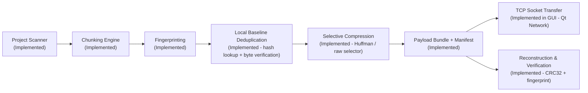
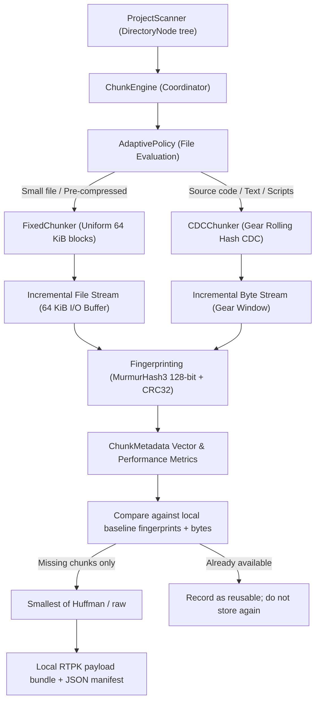

# RetroTransfer

## Build and run on Windows

The Windows build uses CMake, Ninja, the MSYS2 UCRT64 C/C++ toolchain, and Qt 6
with the Widgets and Network components. From the repository root in
PowerShell, configure and build all application and test targets:

```powershell
$env:Path = "C:\msys64\ucrt64\bin;C:\msys64\usr\bin;$env:Path"
cmake -S . -B build-qt6 -G Ninja `
  -DCMAKE_C_COMPILER="C:\msys64\ucrt64\bin\gcc.exe" `
  -DCMAKE_CXX_COMPILER="C:\msys64\ucrt64\bin\g++.exe" `
  -DCMAKE_PREFIX_PATH="C:\msys64\ucrt64"
cmake --build build-qt6 --parallel
ctest --test-dir build-qt6 --output-on-failure
```

Set the Qt runtime path when launching the GUI so Windows can find `Qt6Core.dll`
and the other Qt DLLs:

```powershell
$env:Path = "C:\msys64\ucrt64\bin;C:\msys64\usr\bin;$env:Path"
.\build-qt6\RetroTransferGUI.exe
```

Launch the text-based setup menu with `.\build-qt6\RetroTransferSetupCLI.exe`,
or the lower-level CLI with `.\build-qt6\RetroTransfer.exe`.

### Test a transfer on one computer

Open PowerShell at the repository root, set the Qt runtime path, and start two
GUI windows:

```powershell
$env:Path = "C:\msys64\ucrt64\bin;C:\msys64\usr\bin;$env:Path"
$app = (Resolve-Path .\build-qt6\RetroTransferGUI.exe).Path
$workingDirectory = Split-Path $app
Start-Process -FilePath $app -WorkingDirectory $workingDirectory
Start-Process -FilePath $app -WorkingDirectory $workingDirectory
```

In the first window, select **Receive from Sender**, choose a destination
folder, and start the receiver. In the second, select **Send to Receiver** and
use `127.0.0.1` as the receiver address. Select the scan JSON, chunk manifest,
and `.rtpack` payload from the same package, then enter the receiver's port and
pairing code. Use an empty destination folder for a full-package test. This
checks the transfer on one machine; it does not test another device's network
or firewall configuration.

### Send a package over the local network

1. On the sender, choose **Scan** and **Compress** to create the scan JSON,
   chunk manifest, and `.rtpack` payload. Use **Compress all** for a complete
   project package or select a baseline for an incremental package.
2. On the receiver, choose **Receive from Sender**, select the destination
   folder, and click **START RECEIVER**. Share the displayed LAN IPv4 address,
   TCP port (default `48321`), and 16-character hexadecimal pairing code with the sender.
3. On the sender, choose **Send to Receiver** and select the existing scan
   JSON, chunk manifest, and `.rtpack` payload. Enter the receiver's address,
   port, and code, then click **SEND PACKAGE**. The receiver verifies all
   three files and reconstructs the project in the selected destination.
   The console reports the folder where the received artifacts are retained.

For the receiver's LAN address, run `ipconfig` and use the IPv4 address for the
active Wi-Fi or Ethernet adapter (not `127.0.0.1`). Both computers should be on
the same trusted LAN. Allow RetroTransfer through the receiver's firewall for
the selected port if prompted. The pairing exchange
mutually authenticates the peers and binds the package sizes and SHA-256
digests, but package contents are **not encrypted**; do not
use this protocol on an untrusted network or expose its port to the internet.
The receiver accepts one package at a time. Interrupted transfers retain
verified blocks in the application data directory and can resume when the
sender retries the exact same scan JSON, manifest, and payload files.
Regenerating any of these files creates a different transfer and will not match
those partial files. The current protocol limits scan JSON and manifests to
256 MiB each and payloads to 64 GiB, and checks available disk space before receiving.

In the text-based setup menu, choose **3. Reconstruct or update a project**.
Enter the chunk manifest path, optionally enter the `.rtpack` path (leave it
blank when the bundle is beside the manifest and has the recorded filename),
then enter the destination folder. Choose an empty folder for a full package,
or the matching baseline project folder to apply an incremental update.

```powershell
# Create a new, empty baseline folder
$baseline = Join-Path $env:TEMP ("RetroTransfer-empty-" + [guid]::NewGuid().ToString("N"))
New-Item -ItemType Directory -Path $baseline | Out-Null

# Package a project
.\build-qt6\RetroTransfer.exe "C:\Projects\MyProject" `
  --baseline $baseline `
  --scan-output project-scan.json `
  --chunks-output project-chunks.json `
  --payload-output project.rtpack
```

### Scan, chunk, and compare project versions
```powershell
.\build-qt6\RetroTransfer.exe "C:\Projects\MyProject-v2" `
  --baseline "C:\Projects\MyProject-v1" `
  --scan-output v2-scan.json `
  --chunks-output v2-chunks.json `
  --payload-output v2-missing.rtpack
```

### Reconstruct or update a project from a package

For a complete package, use `--compress-all` when creating it, then reconstruct
into a new or empty destination:

```powershell
.\build-qt6\RetroTransfer.exe "C:\Projects\MyProject" `
  --compress-all `
  --scan-output project-scan.json `
  --chunks-output project-chunks.json `
  --payload-output project.rtpack

.\build-qt6\RetroTransfer.exe --reconstruct collection\project-chunks.json `
  --payload collection\project.rtpack `
  --output "C:\Projects\MyProject-restored"
```

For an incremental update, create the package with `--baseline`. At the receiver,
make sure the `--output` directory contains the matching baseline version.
Reconstruction finds reusable chunks there, adds the missing chunk data, and
overwrites files listed in the manifest. The same command updates an existing
project folder in place:

```powershell
.\build-qt6\RetroTransfer.exe --reconstruct collection\v2-chunks.json `
  --payload collection\v2-missing.rtpack `
  --output "C:\Projects\MyProject-receiver"
```

The payload option is optional if the `.rtpack` is next to the manifest under the
filename recorded in its metadata. Files not listed in the manifest are left
unchanged; reconstruction does not delete files removed from the source project.
It validates chunk fingerprints and CRC32 values before committing files.

The scan is saved as JSON in the `collection` folder by default:
```powershell
.\build-qt6\RetroTransfer.exe "any directory"
```

To choose the scan and chunk manifest filenames independently, use:
```powershell
.\build-qt6\RetroTransfer.exe "any directory" `
  --scan-output "project-scan.json" `
  --chunks-output "project-chunks.json"
```

Both files are saved in `collection`. The `.json` extension is added if omitted.
The legacy second positional argument still names the scan file. If an identical
scan already exists under another JSON filename, the app reuses that existing
file and avoids creating a duplicate. Existing files are never automatically deleted.

The scan JSON contains a directory tree. Every directory has `name`, `path`,
`directories`, and `files` fields. Every file records its `name`, `path`, `size`,
`type`, and `modificationTime`. The chunk manifest contains the file reconstruction
recipes, per-chunk fingerprints and CRC32 values, and (when packaged) payload
offsets and codecs.

## 1. Project Overview

**RetroTransfer** reduces redundant data in evolving projects. It scans and chunks a current project, can compare its chunks with a locally available baseline project, and writes a bundle containing only missing chunks. The receiver can reconstruct or update a project directory from the JSON recipe and RTPK payload, reusing verified chunks already present there. The GUI can transfer packages over TCP using a one-time pairing code, block acknowledgements, SHA-256 package verification, and resumable partial package files. MurmurHash3, CRC32, Huffman, and selective compression/deduplication are implemented. The per-chunk codec selector chooses Huffman or raw storage for each unique chunk. The network receiver persists verified content-addressed chunks for later incremental packages.

### System Pipeline Roadmap



> [!NOTE]
> Stages currently implemented: **Project Scanner**, **Chunking Engine** (Fixed & CDC), **Chunk Fingerprinting** (MurmurHash3 128-bit & CRC32), **Workload-Aware Adaptive Chunking**, **local baseline comparison with byte verification**, **per-chunk Huffman/raw selection**, **local payload bundle and JSON manifest**, **GUI TCP package transfer**, **receiver pairing**, **block acknowledgements**, **resumable incoming scan/manifest/payload files**, **persistent receiver chunk storage**, and **reconstruction after transfer**.
> Remaining milestone: end-to-end research evaluation across versioned workloads. The current transport is not encrypted and is intended for trusted LAN use only.
> MurmurHash3, CRC32, Huffman, and selective compression/deduplication are implemented in C. Chunking, scanning, CLI orchestration, and the application-facing compression facade remain in C++.

---

## 2. Chunking Engine Architecture

The chunkers process file payloads incrementally instead of loading each whole file into memory. Chunk metadata is retained in memory, so metadata use grows with the number of generated chunks.



---

## 3. Chunk Metadata Structure

Each chunk generates a lightweight `ChunkMetadata` record without retaining raw payload bytes in RAM. This separation ensures scalability to multi-gigabyte repositories:

```cpp
struct ChunkMetadata {
    std::string relativePath;   // Relative file path (e.g., "src/scanner.cpp")
    uint64_t offset;            // Starting byte position in file
    uint64_t length;            // Actual chunk length in bytes
    std::string fingerprint;    // 32-char hex digest (MurmurHash3_x64_128)
    std::string algorithm;      // Strategy used ("fixed" or "cdc")
    uint32_t sequenceNumber;    // Sequential chunk index (0, 1, 2, ...)
    uint32_t crc32;             // IEEE 802.3 CRC32 for corruption detection
};
```

Raw bytes can be retrieved on demand at any time using:
`ChunkEngine::readChunkPayload(filePath, offset, length, buffer);`

---

## 4. Chunking Strategies

### A. Fixed-Size Chunking (`FixedChunker`)
- **Concept**: Partitions a file into uniform fixed-size blocks (default: 64 KiB = 65,536 bytes).
- **Final Chunk**: Correctly accommodates partial trailing bytes without appending zero-byte chunks.
- **Divisible Files**: Files whose size is an exact multiple of chunk size emit exactly $N$ chunks (no trailing empty chunk).
- **Empty Files**: Produces 0 chunks and 0 bytes without error.
- **Use Case**: Serves as the performance baseline and optimal choice for pre-compressed media or high-entropy archives.

### B. Content-Defined Chunking (`CDCChunker`)
- **Concept**: Uses a Gear rolling hash to identify boundaries based on byte content rather than fixed offsets, mitigating the "byte-shift problem" caused by insertions/deletions.
- **Gear Hash Algorithm**:
  A 256-entry 64-bit lookup table `GEAR_MATRIX[256]` updates rolling state with 1 bitwise shift, 1 array lookup, and 1 integer addition per byte:
  $$\text{rolling\_hash} = (\text{rolling\_hash} \ll 1) + \text{GEAR\_MATRIX}[\text{byte}]$$
- The lookup table is generated deterministically from a fixed seed so the same data and configuration produce the same boundaries across runs. The previous table in this branch contained only odd values, making the low-bit-zero boundary condition impossible; the corrected table changes CDC boundaries compared with old manifests. Regenerate old chunk manifests before comparing runs across this fix.
- **Boundary Detection Rules**:
  1. *Minimum Chunk Constraint*: No boundary is evaluated while chunk size $< \text{minChunkSize}$ (default: 16 KiB).
  2. *Content Boundary*: For chunk size $\ge \text{minChunkSize}$, a boundary is declared when:
     $$(\text{rolling\_hash} \ \& \ \text{mask}) == 0$$
     Where $\text{mask} = 2^k - 1$ produces an expected average chunk size of $2^k \approx \text{targetChunkSize}$ (default: 64 KiB).
  3. *Maximum Chunk Constraint*: If chunk size reaches $\text{maxChunkSize}$ (default: 256 KiB) without triggering a content boundary, a hard boundary cut is forced.
  4. *Stream Termination*: Remaining bytes at EOF form the final partial chunk.
- **Advantage**: CDC can preserve boundaries after localized insertions or deletions, improving reuse compared with fixed offsets. The actual reuse rate depends on the input data and chunk parameters; it is not guaranteed to be limited to 1 or 2 chunks.

---

## 5. Chunk Fingerprinting & Integrity Verification

- **MurmurHash3_x64_128**:
  - The C implementation follows the MurmurHash3_x64_128 algorithm for 128-bit non-cryptographic hashing.
  - Formatted as a deterministic 32-character lowercase hexadecimal string.
  - High-throughput non-cryptographic hashing. Actual throughput depends on hardware, compiler, and input size.
  - Handles arbitrary binary streams and embedded null bytes correctly.
- **Collision Safety**:
  - MurmurHash3 is non-cryptographic. Local baseline reuse therefore requires both a matching fingerprint and byte-for-byte equality; fingerprints alone are not treated as proof.
- **CRC32 Checksum**:
  - Standard IEEE 802.3 CRC32 polynomial (`0xEDB88320`) computed for every chunk to detect transport bit corruption.

---

## 6. Workload-Aware Adaptive Chunking Strategy

Rather than naively applying CDC or Fixed chunking uniformly across all files, RetroTransfer evaluates each file's characteristics:

| File Category | Criteria | Chosen Strategy | Algorithmic Rationale |
| :--- | :--- | :--- | :--- |
| **Sub-threshold Files** | Size $\le \text{minChunkSize}$ (16 KiB) | **Fixed** | CDC cannot create an earlier boundary below the minimum; fixed chunking avoids rolling-hash work. With default settings, these files usually fit in one fixed chunk. |
| **Pre-compressed / Media** | `.zip`, `.gz`, `.png`, `.jpg`, `.mp4`, `.pdf`, `.7z` | **Fixed** | These formats often have high entropy; fixed chunking avoids the rolling-hash work. Actual throughput depends on the input and runtime environment. |
| **Source Code & Text** | `.cpp`, `.h`, `.py`, `.java`, `.js`, `.json`, `.md` | **CDC** | Project source files frequently experience localized line insertions and deletions; CDC prevents cascading boundary shifts across subsequent lines. |
| **Large General Data** | Size $> \text{minChunkSize}$ | **CDC** | Content-defined boundaries maximize deduplication resilience across version evolutions. |
| **Explicit CLI Override** | User passes `--strategy fixed` or `--strategy cdc` | **Override** | Direct user instruction unconditionally overrides heuristic decisions. |

Every file decision records its rationale string in the JSON manifest for auditable grading and research evaluation.

---

## 7. Selective Compression (local baseline mode)

Pass `--baseline <folder>` to simulate the receiver having an earlier project copy. RetroTransfer scans and chunks both folders with the same selected chunk strategy and configuration. For each current chunk it:

1. Looks up matching baseline fingerprints.
2. Confirms candidate matches by comparing the actual bytes.
3. Marks exact matches reusable and does not write them to the payload.
4. Checks missing chunks against earlier missing chunks in this project and stores repeated data only once.
5. Measures canonical Huffman output size for each unique missing chunk and stores Huffman data when it is smaller than the raw chunk; otherwise stores raw bytes.
6. Writes a local `.rtpack` file and adds each payload offset, codec, fingerprint, source offset, and size to the chunk JSON manifest.

For a first package with no older copy, use `--compress-all` instead of `--baseline`. This treats every current chunk as missing and packages each unique chunk once. The interactive UI offers this choice when you select compression.

This is **local selective packaging**: the sender's baseline is rescanned on every run. The current file/chunk manifest still describes all current chunks, while `selectiveCompression.payloadChunks` lists only unique missing payload entries. Metrics distinguish chunks missing from the baseline (`missingChunks`) from repeated current-project chunks omitted from storage (`duplicateChunks`). `compressionBytesSaved` measures savings from encoding unique missing input; `totalBytesAvoided` compares all current source bytes with the actual payload plus its header. The network receiver persists verified chunks separately for reuse by later incremental packages. The RTPK artifact can be transferred using the GUI's Send/Receive operations or reconstructed locally with the CLI.

Huffman stores a canonical code-length table per encoded chunk. Huffman and raw payloads are lossless; the manifest records the selected codec for each chunk so the reconstruction engine can decode it.

---

## 8. CLI Usage & Options

The command syntax supports legacy positional arguments and named output options:

```bash
# Basic scan + default adaptive chunking
./RetroTransfer [directory] [output.json]

# Give the scan and chunk manifest independent names (inside collection/)
./RetroTransfer . --scan-output project-scan --chunks-output project-chunks.json

# Compare a new project against an earlier local copy and package only missing chunks
./RetroTransfer "C:\projects\MyProject-v2" --baseline "C:\projects\MyProject-v1" --payload-output v2-missing.rtpack

# Make a first package without an older baseline
./RetroTransfer "C:\projects\MyProject" --compress-all --payload-output first-package.rtpack

# Select chunking strategy explicitly
./RetroTransfer . --scan-output scan.json --strategy fixed --chunk-size 32768
./RetroTransfer . --scan-output scan.json --strategy cdc --min-chunk 4096 --target-chunk 16384 --max-chunk 65536
./RetroTransfer . --strategy adaptive

# Run comparative benchmark across Fixed, CDC, and Adaptive
./RetroTransfer . --benchmark

# Scan-only mode (skip chunking)
./RetroTransfer . --scan-output scan-only.json --no-chunk

# Help
./RetroTransfer --help
```

`--scan-output` defaults to `scan.json`; `--chunks-output` defaults to the scan
name with `_chunks.json` appended. With `--baseline`, `--payload-output` defaults
to `<scan-name>_payload.rtpack`. JSON options accept a filename with or without
`.json`; the payload option accepts a name with or without `.rtpack`. Output names
cannot include a directory and are saved in `collection`. Exact duplicate scan
contents are not written under a second filename. Existing JSON files are kept,
and explicitly selected output files may be overwritten.

Chunk-size arguments must be positive integers no larger than 1 GiB. Invalid or inconsistent sizes are rejected before scanning.

---

## 9. Automated tests

The test sources are part of the project and are built and registered with CTest:

- `ChunkingEngineTests` (`tests/test_chunking.cpp`) covers scanning, chunking,
  fingerprints, adaptive strategy, codecs, compression, and reconstruction.
- `TcpTransferIntegrationTests` (`tests/test_tcp_transfer.cpp`) covers pairing
  rejection, transfer of scan JSON/manifest/payload, integrity checks,
  interruption/resume, reconstruction, and receiver chunk-store reuse.

Run both suites after building:

```powershell
ctest --test-dir build-qt6 --output-on-failure
```

Keep these test files: the CMake targets use them, and they catch regressions
in the core pipeline and network transfer. The TCP integration test uses
localhost and does not require a second computer.

---

## 10. Benchmark & Example Results

Running `RetroTransfer.exe . --benchmark` prints a comparative summary. The
following numbers are an illustrative example, not a performance guarantee;
results depend on the project, hardware, and configuration:

```
============================================================
        RETROTRANSFER CHUNKING STRATEGY BENCHMARK
============================================================
Strategy    Chunks    Unique FPs  Dedup %     Time (ms)     Throughput(MB/s)  Metadata (KB)   
------------------------------------------------------------------------------------
fixed       23        23          0.0%        12.54         8.76              3               
cdc         23        23          0.0%        11.22         9.79              3               
adaptive    23        23          0.0%        9.73          11.29             3               
============================================================
```

Output manifests:
- `collection/scan.json`: Directory hierarchy (unchanged scanner output format)
- `collection/scan_chunks.json`: Full chunk manifest, fingerprints, adaptive rationale, and metrics
- `collection/scan_payload.rtpack`: Created with `--baseline` or `--compress-all`; contains missing chunk bytes encoded with the smallest supported per-chunk codec

---

## 11. Current Limitations & Next Steps

### Current Limitations:
- The adaptive policy currently uses file extension and size heuristics; it does not yet profile runtime Shannon entropy per block.
- Sender baseline chunks are rescanned for each package. On the receiver, verified chunks are persisted in a content-addressed store; destination files are still scanned as a fallback for older chunks.
- TCP transfer is currently available in the Qt GUI, not the CLI. Incoming package files are persistent and resumable, and verified chunks are kept in a content-addressed receiver store. The destination project is still scanned during reconstruction to find reusable chunks that were not already in that store.
- The benchmark covers local chunking strategies; end-to-end transfer/recovery and codec comparisons across versioned workloads remain to be evaluated.

### Recommended Next Steps for Deduplication Stage:
1. **Research evaluation**: Measure deduplication, compression, transfer throughput, interruption recovery, and reconstruction across versioned project workloads.
