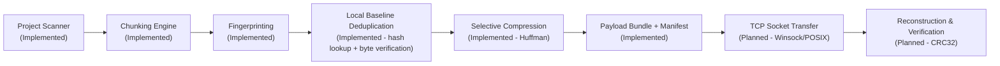
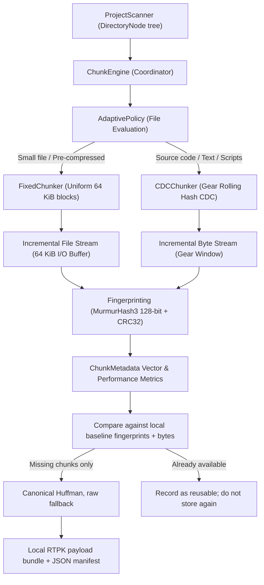

# RetroTransfer

Pratyush
~~~~~~~~~~~~~~~~~~~~~~~~~~~~~~~~~~~~~~~~~~~~~~~~~~~~~~~~~~~~~~~~~~~~~~~~~~

### Quick Build & Run (MinGW / UCRT64 + CMake)

```powershell
# Use the MSYS2 UCRT64 compiler and MinGW Make if they are installed:
$env:Path = "C:\msys64\ucrt64\bin;C:\MinGW\bin;C:\Program Files\CMake\bin;$env:Path"

# Configure a fresh build directory and build
~~~~~~~~~~~~~~~~~~~~~~~~~~~~~~~~~~~~~~~~~~~~~~~~~~~~~~~
cmake -S . -B build-ucrt64 -G "MinGW Makefiles" `
  -DCMAKE_C_COMPILER="C:\msys64\ucrt64\bin\gcc.exe" `
  -DCMAKE_CXX_COMPILER="C:\msys64\ucrt64\bin\g++.exe" `
  -DCMAKE_MAKE_PROGRAM="C:\MinGW\bin\mingw32-make.exe"
cmake --build build-ucrt64 --parallel
~~~~~~~~~~~~~~~~~~~~~~~~~~~~~~~~~~~~~~~~~~~~~~~~~~~~~~~
$env:PATH = 'C:\msys64\ucrt64\bin;C:\msys64\usr\bin;' + $env:PATH
cmake --build build-ucrt64 --parallel
~~~~~~~~~~~~~~~~~~~~~~~~~~~~~~~~~~~~~~~~~~~~~~~~~~~~~~~~~

# Run project scan and adaptive chunking on current directory
.\build-ucrt64\RetroTransfer.exe .

# Run automated test suite
ctest --test-dir build-ucrt64 --output-on-failure
```

#Scan , chunk and compare

```powershell
.\build-ucrt64\RetroTransfer.exe "C:\Projects\MyProject-v2" `
  --baseline "C:\Projects\MyProject-v1" `
  --scan-output v2-scan.json `
  --chunks-output v2-chunks.json `
  --payload-output v2-missing.rtpack
```

The scan is saved as JSON in the `collection` folder by default:
```powershell
.\build-ucrt64\RetroTransfer.exe "any directory"
```

To choose the scan and chunk manifest filenames independently, use:
```powershell
.\build-ucrt64\RetroTransfer.exe "any directory" `
  --scan-output "project-scan.json" `
  --chunks-output "project-chunks.json"
```

Both files are saved in `collection`. The `.json` extension is added if omitted.
The legacy second positional argument still names the scan file. If an identical
scan already exists under another JSON filename, the app reuses that existing
file and avoids creating a duplicate. Existing files are never automatically deleted.

Each saved JSON file contains a directory tree. Every directory has `name`, `path`,
`directories`, and `files` fields. Every file records its `name`, `path`, `size`,
`type`, and `modificationTime`.

## 1. Project Overview

**RetroTransfer** reduces redundant data in evolving projects. It scans and chunks a current project, can compare its chunks with a locally available baseline project, and writes a bundle containing only missing chunks. Missing chunks are encoded with canonical Huffman coding when that makes them smaller; otherwise they are stored raw. Network transfer, persistent receiver storage, and project reconstruction are not implemented.

### System Pipeline Roadmap



> [!NOTE]
> Stages currently implemented: **Project Scanner**, **Chunking Engine** (Fixed & CDC), **Chunk Fingerprinting** (MurmurHash3 128-bit & CRC32), **Workload-Aware Adaptive Chunking**, **local baseline comparison with byte verification**, **per-chunk Huffman compression with raw fallback**, and **a local payload bundle plus JSON manifest**.
> Stages not implemented: persistent receiver chunk storage, TCP/local-network transfer, resumable transfer, receiver-side decompression, and project reconstruction.

---

## 2. Chunking Engine Architecture

The chunkers process file payloads incrementally instead of loading each whole file into memory. Chunk metadata is retained in memory, so metadata use grows with the number of generated chunks.



---

## 3. Chunk Metadata Structure

Each chunk generates a lightweight `ChunkMetadata` record without retaining raw payload bytes in RAM. This separation ensures scalability to multi-gigabyte repositories:

```cpp
struct ChunkMetadata {
    std::string relativePath;   // Relative file path (e.g., "src/scanner.cpp")
    uint64_t offset;            // Starting byte position in file
    uint64_t length;            // Actual chunk length in bytes
    std::string fingerprint;    // 32-char hex digest (MurmurHash3_x64_128)
    std::string algorithm;      // Strategy used ("fixed" or "cdc")
    uint32_t sequenceNumber;    // Sequential chunk index (0, 1, 2, ...)
    uint32_t crc32;             // IEEE 802.3 CRC32 for corruption detection
};
```

Raw bytes can be retrieved on demand at any time using:
`ChunkEngine::readChunkPayload(filePath, offset, length, buffer);`

---

## 4. Chunking Strategies

### A. Fixed-Size Chunking (`FixedChunker`)
- **Concept**: Partitions a file into uniform fixed-size blocks (default: 64 KiB = 65,536 bytes).
- **Final Chunk**: Correctly accommodates partial trailing bytes without appending zero-byte chunks.
- **Divisible Files**: Files whose size is an exact multiple of chunk size emit exactly $N$ chunks (no trailing empty chunk).
- **Empty Files**: Produces 0 chunks and 0 bytes without error.
- **Use Case**: Serves as the performance baseline and optimal choice for pre-compressed media or high-entropy archives.

### B. Content-Defined Chunking (`CDCChunker`)
- **Concept**: Uses a Gear rolling hash to identify boundaries based on byte content rather than fixed offsets, mitigating the "byte-shift problem" caused by insertions/deletions.
- **Gear Hash Algorithm**:
  A 256-entry 64-bit lookup table `GEAR_MATRIX[256]` updates rolling state with 1 bitwise shift, 1 array lookup, and 1 integer addition per byte:
  $$\text{rolling\_hash} = (\text{rolling\_hash} \ll 1) + \text{GEAR\_MATRIX}[\text{byte}]$$
- The lookup table is generated deterministically from a fixed seed so the same data and configuration produce the same boundaries across runs. The previous table in this branch contained only odd values, making the low-bit-zero boundary condition impossible; the corrected table changes CDC boundaries compared with old manifests. Regenerate old chunk manifests before comparing runs across this fix.
- **Boundary Detection Rules**:
  1. *Minimum Chunk Constraint*: No boundary is evaluated while chunk size $< \text{minChunkSize}$ (default: 16 KiB).
  2. *Content Boundary*: For chunk size $\ge \text{minChunkSize}$, a boundary is declared when:
     $$(\text{rolling\_hash} \ \& \ \text{mask}) == 0$$
     Where $\text{mask} = 2^k - 1$ produces an expected average chunk size of $2^k \approx \text{targetChunkSize}$ (default: 64 KiB).
  3. *Maximum Chunk Constraint*: If chunk size reaches $\text{maxChunkSize}$ (default: 256 KiB) without triggering a content boundary, a hard boundary cut is forced.
  4. *Stream Termination*: Remaining bytes at EOF form the final partial chunk.
- **Advantage**: CDC can preserve boundaries after localized insertions or deletions, improving reuse compared with fixed offsets. The actual reuse rate depends on the input data and chunk parameters; it is not guaranteed to be limited to 1 or 2 chunks.

---

## 5. Chunk Fingerprinting & Integrity Verification

- **MurmurHash3_x64_128**:
  - Implements Austin Appleby's reference algorithm for 128-bit non-cryptographic hashing.
  - Formatted as a deterministic 32-character lowercase hexadecimal string.
  - High-throughput non-cryptographic hashing. Actual throughput depends on hardware, compiler, and input size.
  - Handles arbitrary binary streams and embedded null bytes correctly.
- **Collision Safety**:
  - MurmurHash3 is non-cryptographic. Local baseline reuse therefore requires both a matching fingerprint and byte-for-byte equality; fingerprints alone are not treated as proof.
- **CRC32 Checksum**:
  - Standard IEEE 802.3 CRC32 polynomial (`0xEDB88320`) computed for every chunk to detect transport bit corruption.

---

## 6. Workload-Aware Adaptive Chunking Strategy

Rather than naively applying CDC or Fixed chunking uniformly across all files, RetroTransfer evaluates each file's characteristics:

| File Category | Criteria | Chosen Strategy | Algorithmic Rationale |
| :--- | :--- | :--- | :--- |
| **Sub-threshold Files** | Size $\le \text{minChunkSize}$ (16 KiB) | **Fixed** | CDC cannot create an earlier boundary below the minimum; fixed chunking avoids rolling-hash work. With default settings, these files usually fit in one fixed chunk. |
| **Pre-compressed / Media** | `.zip`, `.gz`, `.png`, `.jpg`, `.mp4`, `.pdf`, `.7z` | **Fixed** | These formats often have high entropy; fixed chunking avoids the rolling-hash work. Actual throughput depends on the input and runtime environment. |
| **Source Code & Text** | `.cpp`, `.h`, `.py`, `.java`, `.js`, `.json`, `.md` | **CDC** | Project source files frequently experience localized line insertions and deletions; CDC prevents cascading boundary shifts across subsequent lines. |
| **Large General Data** | Size $> \text{minChunkSize}$ | **CDC** | Content-defined boundaries maximize deduplication resilience across version evolutions. |
| **Explicit CLI Override** | User passes `--strategy fixed` or `--strategy cdc` | **Override** | Direct user instruction unconditionally overrides heuristic decisions. |

Every file decision records its rationale string in the JSON manifest for auditable grading and research evaluation.

---

## 7. Selective Compression (local baseline mode)

Pass `--baseline <folder>` to simulate the receiver having an earlier project copy. RetroTransfer scans and chunks both folders with the same selected chunk strategy and configuration. For each current chunk it:

1. Looks up matching baseline fingerprints.
2. Confirms candidate matches by comparing the actual bytes.
3. Marks exact matches reusable and does not write them to the payload.
4. Checks missing chunks against earlier missing chunks in this project and stores repeated data only once.
5. Huffman-encodes unique missing chunks; if the encoded form is not smaller, stores that chunk raw instead.
6. Writes a local `.rtpack` file and adds each payload offset, codec, fingerprint, source offset, and size to the chunk JSON manifest.

This is **local selective packaging**, not network transfer. The baseline is rescanned on every run; no persistent receiver index is written. The current file/chunk manifest still describes all current chunks, while `selectiveCompression.payloadChunks` lists only unique missing payload entries. Metrics distinguish chunks missing from the baseline (`missingChunks`) from repeated current-project chunks omitted from storage (`duplicateChunks`). `compressionBytesSaved` measures savings from encoding unique missing input; `totalBytesAvoided` compares all current source bytes with the actual payload plus its header. The RTPK file is a temporary hand-off artifact for the future transfer stage; there is not yet a receiver-side decoder or reconstruction command.

The Huffman codec stores a canonical code-length table for each encoded chunk. Chunk payloads that cannot be reduced are stored raw. Huffman is lossless; tests exercise the codec decoder to verify round-trips, but a project-level restore feature is not yet provided.

---

## 8. CLI Usage & Options

The command syntax supports legacy positional arguments and named output options:

```bash
# Basic scan + default adaptive chunking
./RetroTransfer [directory] [output.json]

# Give the scan and chunk manifest independent names (inside collection/)
./RetroTransfer . --scan-output project-scan --chunks-output project-chunks.json

# Compare a new project against an earlier local copy and package only missing chunks
./RetroTransfer "C:\projects\MyProject-v2" --baseline "C:\projects\MyProject-v1" --payload-output v2-missing.rtpack

# Select chunking strategy explicitly
./RetroTransfer . --scan-output scan.json --strategy fixed --chunk-size 32768
./RetroTransfer . --scan-output scan.json --strategy cdc --min-chunk 4096 --target-chunk 16384 --max-chunk 65536
./RetroTransfer . --strategy adaptive

# Run comparative benchmark across Fixed, CDC, and Adaptive
./RetroTransfer . --benchmark

# Scan-only mode (skip chunking)
./RetroTransfer . --scan-output scan-only.json --no-chunk

# Help
./RetroTransfer --help
```

`--scan-output` defaults to `scan.json`; `--chunks-output` defaults to the scan
name with `_chunks.json` appended. With `--baseline`, `--payload-output` defaults
to `<scan-name>_payload.rtpack`. JSON options accept a filename with or without
`.json`; the payload option accepts a name with or without `.rtpack`. Output names
cannot include a directory and are saved in `collection`. Exact duplicate scan
contents are not written under a second filename. Existing JSON files are kept,
and explicitly selected output files may be overwritten.

Chunk-size arguments must be positive integers no larger than 1 GiB. Invalid or inconsistent sizes are rejected before scanning.

---

## 9. Automated Testing

RetroTransfer includes a dedicated CTest suite covering chunking, scanning, adaptive policy, and compression behavior:

```bash
ctest --test-dir build --output-on-failure
# or run executable directly:
./build/test_chunking.exe
```

### Covered Test Cases:
1. `test_empty_file` (0 bytes $\to$ 0 chunks, no empty chunk)
2. `test_one_byte_file` (1 byte $\to$ 1 chunk of length 1)
3. `test_smaller_than_chunk_size` (sub-chunk handling)
4. `test_exact_chunk_size` (exact 1 chunk, no trailing chunk)
5. `test_exactly_divisible_by_chunk_size` ($N \times \text{size} \to$ exactly $N$ chunks)
6. `test_not_divisible_by_chunk_size` (accurate partial last chunk)
7. `test_binary_data_embedded_nulls` (binary safety, embedded 0x00)
8. `test_identical_files_produce_identical_fingerprints` (determinism)
9. `test_changed_contents_produce_different_fingerprints` (checks that modified content changes the fingerprint)
10. `test_correct_offsets_and_lengths` (accurate offset summation and byte reread)
11. `test_cdc_min_chunk_size_behavior` (no chunk $< \text{minChunkSize}$ except EOF)
12. `test_cdc_max_chunk_size_behavior` (no chunk $> \text{maxChunkSize}$)
13. `test_cdc_deterministic_output` (CDC determinism across runs)
14. `test_invalid_configurations` (error handling for invalid size configs)
15. `test_missing_unreadable_file` (graceful error handling)
16. `test_large_file_incremental` (1 MB streaming verification)
17. `test_adaptive_mode_heuristics` (verifies rule tree for code, zip, and small files)
18. `test_explicit_mode_overrides` (override flag verification)
19. `test_cdc_content_boundaries_trigger` (ensures CDC finds content-defined cuts before max size and file/buffer paths agree)
20. `test_scanner_skips_generated_dirs_and_symlinks` (avoids self-scanning generated data and symlink recursion)
21. `test_payload_reread_and_byte_comparison` (rereads bytes and compares them directly)
22. `test_version_comparison_metrics` (reusable bytes & reuse ratio calculation)
23. `test_crc32_standard_vector` (validates the standard CRC32 result for `123456789`)
24. `test_huffman_round_trip` (binary and empty-input Huffman encode/decode)
25. `test_selective_huffman_compression` (baseline reuse, missing chunk selection, bundle read and Huffman round-trip)

---

## 10. Benchmark & Example Results

Running `./RetroTransfer . scan.json --benchmark` prints a comparative summary. The following numbers are an illustrative example, not a performance guarantee; results depend on the project, hardware, and configuration:

```
============================================================
        RETROTRANSFER CHUNKING STRATEGY BENCHMARK           
============================================================
Strategy    Chunks    Unique FPs  Dedup %     Time (ms)     Throughput(MB/s)  Metadata (KB)   
------------------------------------------------------------------------------------
fixed       23        23          0.0%        12.54         8.76              3               
cdc         23        23          0.0%        11.22         9.79              3               
adaptive    23        23          0.0%        9.73          11.29             3               
============================================================
```

Output manifests:
- `collection/scan.json`: Directory hierarchy (unchanged scanner output format)
- `collection/scan_chunks.json`: Full chunk manifest, fingerprints, adaptive rationale, and metrics
- `collection/scan_payload.rtpack`: Created only with `--baseline`; contains missing chunk bytes, Huffman-coded where smaller and raw otherwise

---

## 11. Current Limitations & Next Steps

### Current Limitations:
- The adaptive policy currently uses file extension and size heuristics; it does not yet profile runtime Shannon entropy per block.
- Baseline chunks are rescanned for each run; there is no persistent receiver chunk index.
- The bundle and manifest are local artifacts only. Network transfer, resume, receiver-side decompression, and reconstruction are not implemented.
- Compression is per chunk and currently uses canonical Huffman coding with raw fallback. RLE/LZW and a measured algorithm selector are not implemented.

### Recommended Next Steps for Deduplication Stage:
1. **Persistent receiver index**: Store receiver chunk fingerprints and locations between runs instead of rescanning the baseline folder.
2. **Transfer protocol**: Send the manifest and RTPK payload over local Wi-Fi/LAN, with acknowledgement and resume support.
3. **Receiver decode and reconstruction**: Validate chunk CRCs, decode Huffman-coded chunks, and reconstruct the project tree from a recipe.
